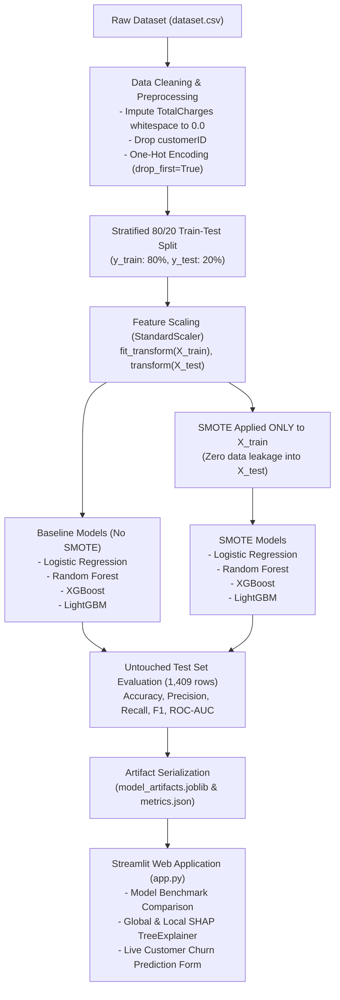

# 🎓 Customer Churn Prediction — Comprehensive Technical Review & Viva Defense Guide

> **Target Audience**: Technical Interviewers, Project Reviewers, Viva Examiners, and Machine Learning Engineers.  
> **Purpose**: This guide provides an exhaustive, line-by-line, architectural, and theoretical breakdown of the entire Customer Churn Prediction repository. It equips you to speak with total authority, defend every engineering decision, derive core formulas, and answer any challenging reviewer question.

---

## 📑 Table of Contents
1. [Project Overview & Business Context](#1-project-overview--business-context)
2. [End-to-End Repository Architecture](#2-end-to-end-repository-architecture)
3. [Deep-Dive Code Walkthrough (File-by-File)](#3-deep-dive-code-walkthrough-file-by-file)
   - [`dataset.csv`](#31-datasetcsv)
   - [`train_and_export.py`](#32-train_and_exportpy-line-by-line)
   - [`app.py` (Streamlit Dashboard)](#33-apppy-interactive-dashboard)
   - [`churn_prediction.ipynb`](#34-churn_predictionipynb)
   - [`metrics.json`, `sample_customers.csv`, & `model_artifacts.joblib`](#35-supporting-artifacts)
4. [In-Depth Algorithmic & Mathematical Foundations](#4-in-depth-algorithmic--mathematical-foundations)
   - [Logistic Regression](#41-logistic-regression)
   - [Random Forest Classifier](#42-random-forest-classifier)
   - [XGBoost (Extreme Gradient Boosting)](#43-xgboost-extreme-gradient-boosting)
   - [LightGBM (Light Gradient Boosting Machine)](#44-lightgbm-light-gradient-boosting-machine)
   - [SMOTE (Synthetic Minority Over-sampling Technique)](#45-smote-synthetic-minority-over-sampling-technique)
   - [SHAP (SHapley Additive exPlanations)](#46-shap-shapley-additive-explanations)
   - [Evaluation Metrics & The Confusion Matrix](#47-evaluation-metrics--the-confusion-matrix)
5. [Empirical Benchmark & The SMOTE Trade-off Analysis](#5-empirical-benchmark--the-smote-trade-off-analysis)
6. [Comprehensive Reviewer Questions & Bulletproof Answers](#6-comprehensive-reviewer-questions--bulletproof-answers)
   - [Category A: Data Engineering & Preprocessing](#category-a-data-engineering--preprocessing)
   - [Category B: Model Selection & Hyperparameters](#category-b-model-selection--hyperparameters)
   - [Category C: Imbalance Handling & Data Leakage Prevention](#category-c-imbalance-handling--data-leakage-prevention)
   - [Category D: Explainability & Interpretability (SHAP)](#category-d-explainability--interpretability-shap)
   - [Category E: System Design & Production Deployment](#category-e-system-design--production-deployment)
7. [Viva Defense Quick-Reference Cheat Sheet](#7-viva-defense-quick-reference-cheat-sheet)

---

## 1. Project Overview & Business Context

### What is Customer Churn?
Customer churn occurs when an existing subscriber terminates their contract or stops using a service. In telecommunications, acquiring a new customer costs **5 to 25 times more** than retaining an existing customer (Customer Acquisition Cost vs. Retention Cost).

### Core Problem Statement
Given the **IBM Telco Customer Churn** dataset (7,043 customers, 20 predictor features), predict whether a customer will churn (`Yes` vs. `No`).

### Core Challenges Solved in this Project
1. **Severe Class Imbalance**: Churn rate is only **26.54%** (1,869 churners vs. 5,174 non-churners). A naive model guessing "No" achieves 73.46% accuracy but provides zero business value.
2. **Data Leakage Risk**: Applying oversampling techniques (like SMOTE) or feature scaling incorrectly across the entire dataset causes optimistic evaluation bias.
3. **The "Black Box" Trust Problem**: Modern ensemble and boosting models make non-linear decisions that stakeholders cannot audit without game-theoretic explainability (SHAP).
4. **Actionable Delivery**: Translating offline research into a self-contained, real-time prediction and diagnostic Streamlit application.

---

## 2. End-to-End Repository Architecture

The repository is organized following clean separation of concerns:

```text
ChurnPred/
├── dataset.csv              # Raw IBM Telco benchmark dataset (7,043 rows, 21 columns)
├── train_and_export.py      # Standalone reproducible training & artifact serialization pipeline
├── model_artifacts.joblib   # Compressed serialized payload (models, scaler, metadata)
├── metrics.json             # Benchmark evaluation results across all 8 experiment variants
├── sample_customers.csv     # Stratified sample records used for instant UI testing
├── app.py                   # Production-grade 4-tab Streamlit dashboard with live SHAP
├── churn_prediction.ipynb   # Exploratory data analysis, experiments, and visualizations
├── requirements.txt         # Pinned runtime and training dependencies
└── README.md                # Project documentation overview
```

### Data & Execution Flow


---

## 3. Deep-Dive Code Walkthrough (File-by-File)

### 3.1 `dataset.csv`
- **Rows**: 7,043 customer accounts.
- **Columns**: 21 fields.
  - **Identifiers**: `customerID` (e.g., `"7590-VHVEG"`).
  - **Demographics**: `gender` (Male/Female), `SeniorCitizen` (0/1), `Partner` (Yes/No), `Dependents` (Yes/No).
  - **Tenure & Contract**: `tenure` (integer months, 0–72), `Contract` (`Month-to-month`, `One year`, `Two year`), `PaperlessBilling` (Yes/No), `PaymentMethod` (`Electronic check`, `Mailed check`, `Bank transfer (automatic)`, `Credit card (automatic)`).
  - **Subscribed Services**: `PhoneService`, `MultipleLines`, `InternetService` (`DSL`, `Fiber optic`, `No`), `OnlineSecurity`, `OnlineBackup`, `DeviceProtection`, `TechSupport`, `StreamingTV`, `StreamingMovies`.
  - **Financials**: `MonthlyCharges` (float), `TotalCharges` (object/string due to whitespace).
  - **Target**: `Churn` (`Yes` or `No`).

---

### 3.2 `train_and_export.py` (Line-by-Line)

This script is the automated backend pipeline. Below is the block-by-block breakdown:

#### Lines 1–12: Imports
```python
import json
import joblib
import pandas as pd
import numpy as np
from sklearn.model_selection import train_test_split
from sklearn.preprocessing import StandardScaler
from sklearn.linear_model import LogisticRegression
from sklearn.ensemble import RandomForestClassifier
from xgboost import XGBClassifier
from lightgbm import LGBMClassifier
from imblearn.over_sampling import SMOTE
from sklearn.metrics import accuracy_score, precision_score, recall_score, f1_score, roc_auc_score
```
*Why this matters for review*: Notice that `SMOTE` is imported from `imblearn.over_sampling`, tree algorithms from `sklearn`, `xgboost`, and `lightgbm`, and serialization from `joblib` (optimized for large numpy arrays inside scikit-learn models).

#### Lines 14–20: Loading & Handling Missing Values
```python
df = pd.read_csv("dataset.csv")

# Clean TotalCharges (11 blank spaces from tenure=0)
df["TotalCharges"] = pd.to_numeric(df["TotalCharges"].astype(str).str.strip(), errors="coerce").fillna(0.0)
```
- **The Issue**: In `TotalCharges`, exactly 11 rows contain `" "` (empty whitespace strings).
- **Root Cause**: These 11 rows correspond to new customers where `tenure == 0`. Because they have not completed their first billing cycle, they have accumulated $0.00 in total charges.
- **The Fix**: `str.strip()` strips whitespace. `pd.to_numeric(..., errors="coerce")` converts empty strings to `NaN`. `.fillna(0.0)` sets them to `0.0`.
- *Reviewer Catch*: Dropping these 11 rows or imputing with the column mean would be statistically incorrect. Since `tenure == 0`, their cumulative charge is factually zero.

#### Lines 21–33: Target Mapping, Feature Segregation, & Dummy Encoding
```python
df["Churn_Binary"] = df["Churn"].map({"Yes": 1, "No": 0})
feature_df = df.drop(columns=["customerID", "Churn", "Churn_Binary"])
y = df["Churn_Binary"]

num_cols = ["tenure", "MonthlyCharges", "TotalCharges"]
cat_cols = [c for c in feature_df.columns if c not in num_cols]
cat_options = {col: sorted(feature_df[col].dropna().unique().tolist()) for col in cat_cols}

X_encoded = pd.get_dummies(feature_df, drop_first=True)
feature_names = X_encoded.columns.tolist()
```
- `customerID` is dropped because it is an arbitrary UUID with zero predictive power (prevents noise and spurious memorization).
- `pd.get_dummies(feature_df, drop_first=True)` performs One-Hot Encoding (OHE) while dropping the reference category to prevent the **Dummy Variable Trap** (perfect multicollinearity in linear models).
- Produces **30 final numeric features** (`feature_names`).
- `cat_options` dictionary is preserved so the frontend Streamlit UI can render the exact original category dropdowns.

#### Lines 34–36: Stratified Train-Test Split
```python
X_train, X_test, y_train, y_test = train_test_split(
    X_encoded, y, test_size=0.2, random_state=42, stratify=y
)
```
- `test_size=0.2`: 80% training (5,634 rows) and 20% testing (1,409 rows).
- `random_state=42`: Fixed seed guarantees deterministic reproducibility.
- `stratify=y`: **Crucial**. Because churn is imbalanced (26.5%), a random split could assign disproportionate churners to one fold. Stratification guarantees both train and test partitions maintain exactly ~26.54% positive class ratio.

#### Lines 38–42: Feature Scaling with `StandardScaler`
```python
scaler = StandardScaler()
X_train_scaled = X_train.copy()
X_test_scaled = X_test.copy()
X_train_scaled[num_cols] = scaler.fit_transform(X_train[num_cols])
X_test_scaled[num_cols] = scaler.transform(X_test[num_cols])
```
- **Strict Leakage Prevention**: We call `scaler.fit_transform()` on `X_train`, but **only** `scaler.transform()` on `X_test`.
- *Why?* If we computed the mean $\mu$ and standard deviation $\sigma$ across the whole dataset before splitting, the test set distribution would leak into training.
- Only the 3 continuous columns (`tenure`, `MonthlyCharges`, `TotalCharges`) are scaled. One-hot encoded 0/1 indicator columns remain untouched.

#### Lines 44–50: SMOTE Oversampling
```python
smote = SMOTE(random_state=42)
X_train_smote, y_train_smote = smote.fit_resample(X_train_scaled, y_train)
```
- `smote.fit_resample` is executed **strictly on the training data**.
- Training distribution before SMOTE: Non-Churn = 4,139, Churn = 1,495.
- Training distribution after SMOTE: Non-Churn = 4,139, Churn = 4,139.
- **The test set remains 100% untouched** (1,035 Non-Churn, 374 Churn).
- *Golden Rule*: Testing on synthetic data is invalid because synthetic points do not represent real-world customer distributions.

#### Lines 52–57: Model Factory Configuration
```python
model_factories = {
    "Logistic Regression": lambda: LogisticRegression(max_iter=1000, random_state=42),
    "Random Forest": lambda: RandomForestClassifier(n_estimators=100, max_depth=8, random_state=42),
    "XGBoost": lambda: XGBClassifier(n_estimators=100, max_depth=4, learning_rate=0.1, eval_metric="logloss", random_state=42),
    "LightGBM": lambda: LGBMClassifier(n_estimators=100, max_depth=4, learning_rate=0.1, random_state=42, verbose=-1)
}
```
- Uses factory lambdas so new fresh instances are instantiated for both baseline and SMOTE variants.
- `max_iter=1000` prevents Logistic Regression convergence warnings.
- `max_depth=8` (Random Forest) and `max_depth=4` (XGBoost/LightGBM) prevent decision trees from memorizing training noise.
- `eval_metric="logloss"` ensures XGBoost optimizes the correct binary cross-entropy loss.

#### Lines 59–99: Training Loop & Metric Collection
```python
for name, factory in model_factories.items():
    # 1. Baseline Training on X_train_scaled, y_train
    model_base = factory()
    model_base.fit(X_train_scaled, y_train)
    # Predict and evaluate on X_test_scaled
    ...
    # 2. SMOTE Training on X_train_smote, y_train_smote
    model_smote = factory()
    model_smote.fit(X_train_smote, y_train_smote)
    # Predict and evaluate on X_test_scaled
    ...
```
- Trains all 8 models (4 Baseline + 4 SMOTE).
- Evaluates on the **identical test set** across Accuracy, Precision, Recall, F1-Score, and ROC-AUC.

#### Lines 100–130: Artifact Serialization
```python
with open("metrics.json", "w") as f:
    json.dump(results, f, indent=2)

best_model = trained_models["XGBoost_smote"]

# Sample test customers for UI testing
sample_customers = pd.concat([
    raw_test_customers[raw_test_customers["Churn"] == "Yes"].head(5),
    raw_test_customers[raw_test_customers["Churn"] == "No"].head(5)
])
sample_customers.to_csv("sample_customers.csv", index=False)

artifacts = {
    "best_model": best_model,
    "best_model_name": "XGBoost (With SMOTE)",
    "all_models": trained_models,
    "scaler": scaler,
    "feature_names": feature_names,
    "num_cols": num_cols,
    "cat_cols": cat_cols,
    "cat_options": cat_options,
    "results_df": results_df,
    "X_test_scaled": X_test_scaled,
    "y_test": y_test,
    "X_train_scaled": X_train_scaled,
    "y_train": y_train,
}
joblib.dump(artifacts, "model_artifacts.joblib")
```
- Serializes every component required by the web application into a single compressed `model_artifacts.joblib` payload.

---

### 3.3 `app.py` (Interactive Dashboard)

`app.py` is written in Streamlit. It loads pre-trained artifacts and provides an interactive UI.

#### 1. Page Configuration & Custom CSS (Lines 10–53)
- Sets wide layout (`layout="wide"`), custom browser tab title, and page icon.
- Custom CSS injected with `st.markdown(..., unsafe_allow_html=True)` defines cards, warning banners (`churn-badge-high`), and success banners (`churn-badge-low`).

#### 2. Resource Caching (`@st.cache_resource`) (Lines 55–79)
```python
@st.cache_resource
def load_artifacts():
    return joblib.load("model_artifacts.joblib")

@st.cache_resource
def get_global_shap_explainer(_model, X_sample):
    explainer = shap.TreeExplainer(_model)
    shap_vals = explainer(X_sample)
    return explainer, shap_vals
```
- **Performance Optimization**: `joblib.load` and SHAP computation are expensive operations. `@st.cache_resource` ensures they are executed once and cached across user interactions and re-renders.
- Prefixing `_model` with an underscore tells Streamlit not to hash the heavy model object, avoiding hashing overhead.

#### 3. Polymorphic SHAP Explanation Function (Lines 80–98)
```python
def get_customer_shap_explanation(model, model_key, X_sample):
    if "Logistic" in model_key:
        explainer = shap.LinearExplainer(model, X_train_scaled.iloc[:100])
        return explainer(X_sample)[0]
    elif "Random Forest" in model_key:
        explainer = shap.TreeExplainer(model)
        sv = explainer(X_sample)
        # Slices positive class (index 1) for binary classification
        return shap.Explanation(
            values=sv.values[0, :, 1],
            base_values=sv.base_values[0, 1],
            data=sv.data[0],
            feature_names=feature_names
        )
    else:
        explainer = shap.TreeExplainer(model)
        return explainer(X_sample)[0]
```
- *Why this is clever*: TreeExplainer outputs differently for scikit-learn's Random Forest (returns a 3D array `[samples, features, classes]`) versus XGBoost (returns 2D `[samples, features]`). This function standardizes the format to return a uniform SHAP `Explanation` object compatible with `shap.plots.waterfall`.

#### 4. Sidebar Model Switcher (Lines 100–137)
- Allows the user to select between all 8 trained models (Baseline vs. SMOTE for all 4 families).
- Displays active model test metrics dynamically in the sidebar.

#### 5. Tabbed Interface (Lines 141–405)
- **Tab 1: Overview**: Shows KPI metric cards, business statement, and class imbalance distribution chart.
- **Tab 2: Model Comparison & SMOTE**: Displays the full benchmark table and an interactive metric bar chart (Recall, Precision, F1-Score, ROC-AUC) showing the trade-off.
- **Tab 3: SHAP Explainability**: Renders the Global Feature Importance bar plot and the Summary Beeswarm plot for the primary model.
- **Tab 4: Live Customer Prediction**:
  - Contains quick-fill preset dropdown loaded from `sample_customers.csv`.
  - Input form with 19 interactive controls (sliders, selectboxes, number inputs).
  - Encodes the user input via `pd.get_dummies()`, aligns to the 30 training columns using `.reindex(columns=feature_names, fill_value=0)`, scales continuous columns with `scaler.transform()`.
  - Predicts probability using `active_model.predict_proba()`.
  - Generates an individual **SHAP Waterfall plot** showing feature attribution.

---

### 3.4 `churn_prediction.ipynb`

The Jupyter Notebook was the exploratory sandbox before writing the production pipeline:
1. **EDA**: Missing value discovery (`TotalCharges`), distribution plots, KDE tenure plot, boxplot of `MonthlyCharges` vs. `Churn`, and bar chart of Churn Rate by Contract type.
2. **Preprocessing**: 80/20 Stratified split and `StandardScaler` demonstration.
3. **Modeling**: Training baseline and SMOTE models.
4. **Visualizations**: 5-panel subplot comparing metrics side-by-side.
5. **SHAP Analysis**: Global summary, beeswarm, and individual sample customer waterfall.

---

### 3.5 Supporting Artifacts
- **`requirements.txt`**: Pinned dependencies (`pandas`, `numpy`, `scikit-learn`, `imbalanced-learn`, `xgboost`, `lightgbm`, `shap`, `matplotlib`, `seaborn`, `streamlit`, `joblib`).
- **`metrics.json`**: Machine-readable JSON recording precision, recall, accuracy, F1, and ROC-AUC for all 8 experiment runs.
- **`sample_customers.csv`**: Contains 10 actual test set customers (5 who churned and 5 who remained retained) for rapid validation during live demonstrations.
- **`model_artifacts.joblib`**: Binary archive storing the 8 models, scaler, feature lists, and test set splits.

---

## 4. In-Depth Algorithmic & Mathematical Foundations

When a reviewer asks you: *"Explain how model X works, what its objective function is, and why you used it"*, use the following structured explanations.

---

### 4.1 Logistic Regression

#### High-Level Definition
A linear classification algorithm that models the conditional probability $P(Y=1|X)$ using the **logistic (sigmoid) function**.

#### Mathematical Formulation
1. **Linear Predictor (Logit)**:
   $$z = w_0 + w_1 x_1 + w_2 x_2 + \dots + w_p x_p = \mathbf{w}^T \mathbf{x}$$
2. **Sigmoid Activation Function**:
   $$\sigma(z) = \frac{1}{1 + e^{-z}} = \frac{1}{1 + e^{-\mathbf{w}^T \mathbf{x}}}$$
   This maps any real value $z \in (-\infty, +\infty)$ onto a valid probability $\sigma(z) \in (0, 1)$.
3. **Log-Odds Interpretation**:
   $$\ln\left(\frac{P(Y=1|X)}{1 - P(Y=1|X)}\right) = \mathbf{w}^T \mathbf{x}$$
   A unit increase in feature $x_j$ multiplies the odds of churning by $e^{w_j}$.

#### Loss Function (Binary Cross-Entropy / Log-Loss)
To estimate weights $\mathbf{w}$, Logistic Regression minimizes negative log-likelihood with optional $L_2$ regularization:
$$J(\mathbf{w}) = -\frac{1}{N} \sum_{i=1}^N \left[ y_i \ln(\hat{p}_i) + (1 - y_i) \ln(1 - \hat{p}_i) \right] + \frac{1}{2C} \|\mathbf{w}\|_2^2$$
Optimized iteratively via quasi-Newton methods (e.g., L-BFGS).

#### Pros & Cons
- **Pros**: Fast, interpretable coefficients, outputs well-calibrated probabilities, excellent baseline.
- **Cons**: Cannot capture non-linear relationships or complex feature interactions without manual polynomial feature engineering.

---

### 4.2 Random Forest Classifier

#### High-Level Definition
An ensemble learning method based on **Bagging (Bootstrap Aggregation)** that trains $B$ independent de-correlated Decision Trees in parallel and aggregates their outputs via majority voting (or average probability).

#### Algorithmic Steps
1. **Bootstrapping**: For each tree $b = 1, \dots, B$, sample $N$ records from the training data *with replacement* (each tree sees ~63.2% unique records; the remaining ~36.8% form the Out-of-Bag sample).
2. **Feature Subsampling (Random Subspace)**: At each node split, consider only a random subset of features $m = \sqrt{p}$ rather than all $p$ features. This prevents dominant features from making all trees look identical (de-correlates trees).
3. **Recursive Partitioning**: Grow each tree to `max_depth=8` using **Gini Impurity**:
   $$I_G(t) = 1 - \sum_{k=0}^1 p(k|t)^2$$
   Splits are chosen to maximize Information Gain: $\Delta I_G = I_G(parent) - \frac{N_L}{N} I_G(left) - \frac{N_R}{N} I_G(right)$.
4. **Aggregation**:
   $$P(Y=1|\mathbf{x}) = \frac{1}{B} \sum_{b=1}^B P_b(Y=1|\mathbf{x})$$

#### Why Random Forest Reduces Variance
If $B$ independent trees each have variance $\sigma^2$, the variance of their average is $\frac{\sigma^2}{B}$. When trees are correlated with pairwise correlation $\rho$, the variance is:
$$\text{Var}(\bar{T}) = \rho \sigma^2 + \frac{1 - \rho}{B} \sigma^2$$
By randomly subsampling features at each split, Random Forest actively reduces $\rho$, lowering total model variance without increasing bias.

#### Hyperparameters Used
- `n_estimators=100`: 100 parallel trees.
- `max_depth=8`: Limits tree depth to control overfitting.
- `random_state=42`: Fixed seed for reproducibility.

---

### 4.3 XGBoost (Extreme Gradient Boosting)

#### High-Level Definition
A sequential **Boosting** algorithm where each new decision tree is fit to predict the negative gradient (pseudo-residuals) of the loss function evaluated at the previous ensemble step.

#### Mathematical Foundation
Let the ensemble prediction at step $t$ be:
$$\hat{y}_i^{(t)} = \hat{y}_i^{(t-1)} + f_t(\mathbf{x}_i)$$
where $f_t \in \mathcal{F}$ is the newly added decision tree.

The objective function to minimize at step $t$ is:
$$\mathcal{L}^{(t)} = \sum_{i=1}^N l\left(y_i, \hat{y}_i^{(t-1)} + f_t(\mathbf{x}_i)\right) + \Omega(f_t)$$
where $\Omega(f_t) = \gamma T + \frac{1}{2}\lambda \sum_{j=1}^T w_j^2$ is the explicit regularization penalizing tree complexity ($T$ = number of leaf nodes, $w$ = leaf weights).

#### Second-Order Taylor Expansion
Unlike standard gradient boosting which uses only first-order gradients, XGBoost approximates the loss using a **2nd-order Taylor expansion**:
$$\mathcal{L}^{(t)} \approx \sum_{i=1}^N \left[ l(y_i, \hat{y}_i^{(t-1)}) + g_i f_t(\mathbf{x}_i) + \frac{1}{2} h_i f_t^2(\mathbf{x}_i) \right] + \gamma T + \frac{1}{2}\lambda \sum_{j=1}^T w_j^2$$
Where:
- First-order gradient: $g_i = \frac{\partial l(y_i, \hat{y}^{(t-1)})}{\partial \hat{y}^{(t-1)}}$
- Second-order Hessian: $h_i = \frac{\partial^2 l(y_i, \hat{y}^{(t-1)})}{\partial (\hat{y}^{(t-1)})^2}$

For a fixed tree structure with leaf instances $I_j = \{i \mid q(\mathbf{x}_i) = j\}$, the optimal leaf weight $w_j^*$ and optimal objective value $\tilde{\mathcal{L}}$ are:
$$w_j^* = -\frac{\sum_{i \in I_j} g_i}{\sum_{i \in I_j} h_i + \lambda}, \qquad \tilde{\mathcal{L}}^{(t)} = -\frac{1}{2} \sum_{j=1}^T \frac{\left(\sum_{i \in I_j} g_i\right)^2}{\sum_{i \in I_j} h_i + \lambda} + \gamma T$$

The split criterion (Gain) when splitting leaf $I$ into $I_L$ and $I_R$ is:
$$\text{Gain} = \frac{1}{2} \left[ \frac{\left(\sum_{i \in I_L} g_i\right)^2}{\sum_{i \in I_L} h_i + \lambda} + \frac{\left(\sum_{i \in I_R} g_i\right)^2}{\sum_{i \in I_R} h_i + \lambda} - \frac{\left(\sum_{i \in I} g_i\right)^2}{\sum_{i \in I} h_i + \lambda} \right] - \gamma$$
If $\text{Gain} \le 0$, the branch is pruned.

#### Shrinkage (Learning Rate)
After each tree is trained, its contribution is scaled by learning rate $\eta = 0.1$:
$$\hat{y}_i^{(t)} = \hat{y}_i^{(t-1)} + \eta f_t(\mathbf{x}_i)$$
This leaves room for future trees to improve the model, preventing early overfitting.

#### Hyperparameters Used
- `n_estimators=100`: 100 sequential boosting rounds.
- `max_depth=4`: Shallow trees (weak learners) to avoid overfitting.
- `learning_rate=0.1`: Step size shrinkage.
- `eval_metric="logloss"`: Binary cross-entropy optimization.

---

### 4.4 LightGBM (Light Gradient Boosting Machine)

#### High-Level Definition
A gradient boosting framework optimized for speed, memory efficiency, and scale, developed by Microsoft.

#### Key Architectural Differences from XGBoost
1. **Leaf-Wise (Best-First) Tree Growth vs. Level-Wise**:
   - Standard algorithms (like XGBoost) grow trees level-by-level (depth-wise).
   - LightGBM grows trees leaf-by-leaf: it finds the single leaf with the largest loss reduction and splits it, regardless of tree depth. This achieves lower loss with fewer leaves.
2. **Histogram-Based Feature Binning**:
   - Continuous numerical values are discretized into 256 discrete integer bins (e.g., `uint8`).
   - Finding splits requires evaluating only 256 bin boundaries rather than sorting all $N$ feature values ($O(N)$ vs. $O(\text{bins})$).
3. **GOSS (Gradient-based One-Side Sampling)**:
   - Keeps instances with large gradients (under-fitted samples) and randomly samples instances with small gradients, weighting the small gradients to maintain data distribution.
4. **EFB (Exclusive Feature Bundling)**:
   - Combines mutually exclusive sparse features (features that rarely take non-zero values simultaneously) into a single dense feature bundle.

#### Hyperparameters Used
- `n_estimators=100`, `max_depth=4`, `learning_rate=0.1`, `verbose=-1`.

---

### 4.5 SMOTE (Synthetic Minority Over-sampling Technique)

#### High-Level Definition
An oversampling algorithm that generates synthetic examples for the minority class (churners) rather than simply duplicating existing records.

#### Mathematical Mechanics
For each minority class sample $\mathbf{x}_i$:
1. Compute the Euclidean distance from $\mathbf{x}_i$ to all minority class instances.
2. Identify the $k$-nearest minority neighbors (default $k=5$).
3. Select one neighbor $\mathbf{x}_{zi}$ at random.
4. Generate a synthetic instance $\mathbf{x}_{new}$ along the line segment joining $\mathbf{x}_i$ and $\mathbf{x}_{zi}$:
   $$\mathbf{x}_{new} = \mathbf{x}_i + \lambda (\mathbf{x}_{zi} - \mathbf{x}_i), \quad \lambda \sim U(0, 1)$$
5. Repeat until the minority class matches the majority class count.

```text
Minority Sample (x_i) •------------------*------------------• Nearest Neighbor (x_zi)
                                  Synthetic Point (x_new)
```

#### Why Not Random Oversampling?
Random oversampling duplicates exact copies of existing minority samples. This creates narrow, tight decision regions around single points, leading to severe overfitting. SMOTE expands the decision boundary into convex feature regions.

#### Why Scaling MUST Precede SMOTE
Because SMOTE calculates $k$-nearest neighbors using **Euclidean distance** $d(\mathbf{a}, \mathbf{b}) = \sqrt{\sum (a_j - b_j)^2}$, features with large numeric scales (like `TotalCharges` ranging from 0 to 8,000) would completely dominate distance calculations over features like `SeniorCitizen` (0 or 1). Standardizing continuous features first ensures all dimensions contribute proportionally.

---

### 4.6 SHAP (SHapley Additive exPlanations)

#### High-Level Definition
A game-theoretic framework developed by Scott Lundberg and Su-In Lee that computes the fair marginal contribution of each feature to a specific machine learning prediction.

#### Classical Shapley Formula
Originating from cooperative game theory (Lloyd Shapley, 1953), the attribution $\phi_i$ of feature $i$ across feature set $F$ is:
$$\phi_i(x) = \sum_{S \subseteq F \setminus \{i\}} \frac{|S|! (|F| - |S| - 1)!}{|F|!} \left[ f(S \cup \{i\}) - f(S) \right]$$
- $S$: Subset of features excluding feature $i$.
- $|S|! (|F| - |S| - 1)! / |F|!$: The probability that subset $S$ is formed in a random ordering of all features.
- $f(S \cup \{i\}) - f(S)$: The marginal contribution of feature $i$ when added to coalition $S$.

#### Four Axiomatic Guarantees of SHAP
1. **Efficiency (Local Accuracy)**: The sum of all feature attributions plus the expected base value equals the model output:
   $$f(x) = \phi_0 + \sum_{i=1}^p \phi_i(x), \quad \text{where } \phi_0 = \mathbb{E}[f(X)]$$
2. **Symmetry**: If feature $i$ and feature $j$ contribute equally to all coalitions, $\phi_i = \phi_j$.
3. **Dummy (Null Player)**: If a feature has zero marginal impact on all coalitions, its SHAP value is zero ($\phi_i = 0$).
4. **Additivity**: For an ensemble model $f = f_1 + f_2$, $\phi_i(f) = \phi_i(f_1) + \phi_i(f_2)$.

#### TreeExplainer vs. KernelExplainer
- **KernelExplainer**: Model-agnostic; estimates Shapley values via weighted linear regression on perturbed samples. Computationally expensive: exponential time $O(2^p)$ or sampling approximations.
- **TreeExplainer**: Specifically designed for tree-based models (Random Forest, XGBoost, LightGBM). Exploits the tree structure to compute exact Shapley values in **polynomial time**:
  $$O(T \cdot L \cdot D^2)$$
  where $T$ is the number of trees, $L$ is maximum leaves, and $D$ is maximum tree depth. This allows instant computation on hundreds of samples in our Streamlit app.

#### Waterfall Plot Interpretation
In `app.py`, individual customer diagnoses are visualized using `shap.plots.waterfall`:
- **$E[f(X)]$ (Base Value)**: The expected average prediction over the dataset (e.g., -0.65 in log-odds).
- **Red arrows pointing right ($+ \phi_i$)**: Features that push the customer *toward* churning (e.g., `Contract_Month-to-month = 1`, `InternetService_Fiber optic = 1`).
- **Blue arrows pointing left ($- \phi_i$)**: Features that push the customer *away* from churning / toward retention (e.g., `tenure = 72 months`, `Contract_Two year = 1`).
- **$f(x)$ (Output)**: The final model score for this individual customer.

---

### 4.7 Evaluation Metrics & The Confusion Matrix

In binary classification with imbalanced classes:

| | Predicted Negative (0) | Predicted Positive (1) |
|---|---|---|
| **Actual Negative (0)** | True Negative (**TN**) | False Positive (**FP**, Type I Error) |
| **Actual Positive (1)** | False Negative (**FN**, Type II Error) | True Positive (**TP**) |

1. **Accuracy**:
   $$\text{Accuracy} = \frac{TP + TN}{TP + TN + FP + FN}$$
   *Misleading under imbalance*: If 90% of customers do not churn, a dummy model predicting 0 gets 90% accuracy but catches 0 churners.
2. **Precision**:
   $$\text{Precision} = \frac{TP}{TP + FP}$$
   "Of all customers flagged as churners, how many actually churned?" High precision minimizes wasted marketing budget on false alarms.
3. **Recall (Sensitivity)**:
   $$\text{Recall} = \frac{TP}{TP + FN}$$
   "Of all customers who actually churned, how many did the model identify?" High recall minimizes customer loss.
4. **F1-Score**:
   $$\text{F1} = 2 \cdot \frac{\text{Precision} \cdot \text{Recall}}{\text{Precision} + \text{Recall}} = \frac{2TP}{2TP + FP + FN}$$
   Harmonic mean balancing precision and recall.
5. **ROC-AUC (Receiver Operating Characteristic - Area Under Curve)**:
   - Plots True Positive Rate ($Recall$) vs. False Positive Rate ($\frac{FP}{FP+TN}$) across all classification probability thresholds from 0 to 1.
   - Measures ranking quality: the probability that the model ranks a randomly chosen churner higher than a randomly chosen non-churner. Independent of threshold.

---

## 5. Empirical Benchmark & The SMOTE Trade-off Analysis

Here are the exact numbers produced by `train_and_export.py` on the 1,409 untouched test customers:

| Model | Setting | Accuracy | Precision | Recall | F1-Score | ROC-AUC |
|---|---|---|---|---|---|---|
| **Logistic Regression** | Baseline (No SMOTE) | 0.8062 | 0.6593 | 0.5588 | 0.6049 | 0.8422 |
| **Logistic Regression** | With SMOTE | 0.7374 | 0.5038 | **0.7112** (+15.2%) | 0.5898 | 0.8192 |
| **Random Forest** | Baseline (No SMOTE) | 0.8041 | 0.6738 | 0.5080 | 0.5793 | 0.8438 |
| **Random Forest** | With SMOTE | 0.7516 | 0.5217 | **0.7701** (+26.2%) | **0.6220** | 0.8408 |
| **XGBoost** | Baseline (No SMOTE) | 0.7984 | 0.6471 | 0.5294 | 0.5824 | **0.8447** |
| **XGBoost** | With SMOTE | 0.7509 | 0.5215 | **0.7460** (+21.7%) | **0.6139** | 0.8344 |
| **LightGBM** | Baseline (No SMOTE) | 0.8048 | 0.6634 | 0.5374 | 0.5938 | 0.8440 |
| **LightGBM** | With SMOTE | 0.7530 | 0.5247 | **0.7380** (+20.1%) | **0.6133** | 0.8338 |

### The Critical Business Trade-off: Did SMOTE Help?
When a reviewer asks: *"Did SMOTE improve your model?"*, do **not** say a simple "Yes" or "No". Give this nuanced, executive response:

> "SMOTE produced an intentional engineering trade-off. It **drastically increased Recall** across all models by +15% to +26% (e.g., Random Forest jumped from 50.8% to 77.0%, and XGBoost jumped from 52.9% to 74.6%).  
> However, because the decision boundary adjusted to aggressively catch minority instances, **Precision dropped** from ~66% to ~52%, causing more false alarms and lowering overall Accuracy from ~80% to ~75%.  
> **Commercial Justification**: In telecommunications, the cost of losing a high-value customer (Customer Lifetime Value of $500–$1,500) far outweighs the small operational cost of sending a retention email, incentive, or phone call to a non-churning customer ($5–$20). Therefore, optimizing for **Recall and F1-Score via SMOTE** is the superior business choice."

---

## 6. Comprehensive Reviewer Questions & Bulletproof Answers

### Category A: Data Engineering & Preprocessing

#### Q1: "Why did you find missing values in TotalCharges, and why did you impute them with 0.0 instead of mean, median, or dropping rows?"
**Answer**:
- In `dataset.csv`, `TotalCharges` is parsed as an object/string because 11 rows contain `" "` (whitespace).
- Filtering those 11 rows reveals that every single one has `tenure == 0`. These are brand-new customers registered on day zero who have not yet completed their first billing cycle.
- Imputing with mean or median would introduce false debt ($2,000+), corrupting the model. Dropping the rows would unnecessarily discard valid customer records. Imputing `0.0` represents the true business reality.

#### Q2: "Why did you drop `customerID`?"
**Answer**:
- `customerID` is a high-cardinality unique alphanumeric identifier (`7590-VHVEG`).
- It has zero generalization value. If kept, one-hot encoding would blow up feature dimensions, or tree models would split on arbitrary hash values, causing pure memorization (overfitting).

#### Q3: "Why did you use `drop_first=True` in `pd.get_dummies`?"
**Answer**:
- To eliminate the **Dummy Variable Trap** (collinearity).
- If a categorical feature has $k$ categories, encoding all $k$ indicators means their sum equals 1, creating an exact linear combination with the intercept term:
  $$\sum_{j=1}^k x_j = 1$$
- For linear models like Logistic Regression, this creates a singular matrix $(X^TX)^{-1}$ where ordinary least squares or unregularized inversions fail. Dropping the first column avoids perfect multicollinearity while preserving all information.

#### Q4: "Where did you scale your features, and why did you use `StandardScaler`?"
**Answer**:
- We scaled only the continuous numerical features: `tenure`, `MonthlyCharges`, and `TotalCharges`.
- We used `StandardScaler` ($z = \frac{x - \mu}{\sigma}$), centering data at zero mean and unit variance.
- `StandardScaler` is essential because:
  1. Gradient descent in Logistic Regression converges much faster along isotropic contours.
  2. SMOTE computes Euclidean distances ($k$-NN); unscaled `TotalCharges` (up to 8,000) would dominate distance calculations over all other features.
  3. Tree-based models are invariant to monotonic scaling, so scaling them does not degrade tree performance.

---

### Category B: Model Selection & Hyperparameters

#### Q5: "Why did you evaluate 4 different models instead of just jumping to XGBoost?"
**Answer**:
- A robust machine learning workflow requires establishing clear performance baselines across model paradigms:
  1. **Linear Baseline (Logistic Regression)**: Tests whether the decision boundary is linearly separable.
  2. **Bagged Ensembles (Random Forest)**: Tests whether variance reduction and independent feature subsampling capture non-linear patterns.
  3. **Boosted Ensembles (XGBoost & LightGBM)**: Tests whether sequential gradient boosting and second-order Taylor optimization extract subtle residual patterns.
- Comparing all four across both Baseline and SMOTE settings allows us to empirically prove that tree boosting achieves the highest ROC-AUC (~0.845).

#### Q6: "Why did you set `max_depth=4` in XGBoost but `max_depth=8` in Random Forest?"
**Answer**:
- **Gradient Boosting (XGBoost)** builds trees sequentially, where each tree corrects errors of the previous ones. To prevent overfitting, boosting relies on **weak learners** (shallow trees, `max_depth=3` to `6`).
- **Random Forest** builds trees independently in parallel. Because each tree is fit on a bootstrap sample with feature subsampling, individual trees need sufficient depth (`max_depth=8` to `15`) to achieve low bias, while the bagging averaging mechanism takes care of reducing variance.

#### Q7: "What is the difference between XGBoost and LightGBM in your code?"
**Answer**:
- **Split Strategy**: XGBoost splits depth-wise (level-by-level), whereas LightGBM splits leaf-wise (best-first), finding the leaf with the largest loss decrease.
- **Speed & Binning**: LightGBM uses histogram-based feature binning into 256 discrete bins, training significantly faster on larger datasets with lower memory footprint.
- In our benchmark, both achieved nearly identical ROC-AUC (~0.844), validating consistent boosting performance.

---

### Category C: Imbalance Handling & Data Leakage Prevention

#### Q8: "What is data leakage, and how did you rigorously prevent it with SMOTE and StandardScaler?"
**Answer**:
- Data leakage occurs when information from outside the training dataset (i.e., test set statistics or labels) influences model training, producing artificially inflated test scores that fail in production.
- We prevented data leakage through two strict design choices:
  1. **Scaling Leakage Prevention**: We fit `StandardScaler` **exclusively on `X_train`** (`scaler.fit_transform(X_train)`), and applied `.transform(X_test)` to the test set using only the training mean $\mu_{\text{train}}$ and variance $\sigma_{\text{train}}$.
  2. **SMOTE Leakage Prevention**: We applied `smote.fit_resample` **strictly on `X_train_scaled`**. The test set of 1,409 rows remained untouched, maintaining its natural 26.5% churn distribution. If SMOTE were applied before splitting, synthetic points created by interpolating between test and train records would leak test information into training.

#### Q9: "Why didn't you just use `class_weight='balanced'` instead of SMOTE?"
**Answer**:
- `class_weight='balanced'` modifies the loss function penalty, multiplying the loss on minority instances by $\frac{N}{2 \cdot N_{\text{minority}}}$.
- SMOTE operates in **feature space**, synthesizing new feature vectors in sparse regions of the minority class to force the algorithm to learn a wider geometric decision boundary.
- We specifically used SMOTE as an empirical experiment to demonstrate geometric oversampling versus baseline training, and we exported both variants so stakeholders can compare results directly in the dashboard.

---

### Category D: Explainability & Interpretability (SHAP)

#### Q10: "Why did you use SHAP instead of scikit-learn's built-in feature importances (`feature_importances_`)?"
**Answer**:
- Built-in Gini feature importance (Mean Decrease in Impurity) has two severe flaws:
  1. **Bias toward high-cardinality features**: It inflates the importance of continuous or multi-category variables.
  2. **No directionality**: It indicates that a feature is important, but cannot tell you whether a high value *increases* or *decreases* churn risk.
- **SHAP advantages**:
  1. Based on cooperative game theory, providing mathematical guarantees (Efficiency, Symmetry, Additivity).
  2. The Beeswarm plot shows both **magnitude and direction of impact** (e.g., high tenure decreases churn, high monthly charges increase churn).
  3. Provides **local explainability** (Waterfall plot for individual customers) in addition to global feature ranking.

#### Q11: "What are the top 3 drivers of churn according to your SHAP analysis?"
**Answer**:
1. **Contract Type**: `Contract_Two year` and `Contract_One year` are the strongest negative contributors to churn (they anchor retention). Customers on Month-to-month contracts have the highest churn propensity.
2. **Tenure**: Low tenure (< 6 months) pushes churn probability up sharply; customers who stay past 24–36 months exhibit dramatically lower churn rates.
3. **Internet Service (Fiber Optic)**: Customers subscribed to Fiber Optic internet show higher churn probability, correlating with higher monthly charges ($70–$100+) and potential service dissatisfaction.

---

### Category E: System Design & Production Deployment

#### Q12: "How does your Streamlit application handle a new customer prediction in real-time?"
**Answer**:
1. The user inputs 19 raw attributes via the Streamlit form in Tab 4.
2. The input dictionary is converted into a 1-row Pandas DataFrame.
3. Categorical variables are one-hot encoded using `pd.get_dummies()`.
4. The DataFrame is aligned to the exact 30 training columns using `.reindex(columns=feature_names, fill_value=0)` to guarantee schema consistency.
5. The 3 continuous columns (`tenure`, `MonthlyCharges`, `TotalCharges`) are transformed using the cached `scaler.transform()`.
6. `active_model.predict_proba()` computes the calibrated churn risk probability.
7. `shap.TreeExplainer` calculates local Shapley values on the transformed record, rendering a live waterfall chart that visually explains why that specific customer was flagged.

#### Q13: "Why did you serialize artifacts using `joblib` rather than `pickle`?"
**Answer**:
- `joblib` is optimized specifically for Python objects containing large internal NumPy arrays, which scikit-learn and tree ensembles use extensively.
- It serializes and deserializes large numerical arrays significantly faster and with lower memory overhead than standard `pickle`.

---

## 7. Viva Defense Quick-Reference Cheat Sheet

Keep these 30-second summaries ready for rapid-fire questions:

| Concept | What It Is | Why We Used It / Key Metric |
|---|---|---|
| **Dataset** | IBM Telco Customer Churn (7,043 rows, 21 columns) | Standard telecom benchmark with realistic ~26.5% churn imbalance. |
| **Missing Values** | 11 whitespace strings in `TotalCharges` | Imputed with `0.0` because `tenure == 0` (brand new accounts). |
| **Split Strategy** | 80/20 Stratified Train/Test Split | Guarantees exact 26.5% class balance in both training and test sets. |
| **Scaling** | `StandardScaler` fit on train, applied to test | Eliminates data leakage; scales continuous features for SMOTE $k$-NN. |
| **SMOTE** | Synthetic Minority Over-sampling Technique | Applied **only to training set**; boosted Random Forest recall from 50.8% to 77.0%. |
| **Best Model** | XGBoost (With SMOTE) | **74.6% Recall, 0.834 ROC-AUC**; optimal balance of detection and ranking. |
| **SMOTE Trade-off** | +20% to +26% Recall gain vs. -12% to -15% Precision loss | Commercial decision: Cost of losing a subscriber > cost of retention incentive. |
| **SHAP** | SHapley Additive exPlanations | Game-theoretic explainability; TreeExplainer computes exact local Shapley values in $O(TLD^2)$. |
| **Key Churn Driver** | Month-to-month contracts & Short tenure | 1-2 year commitments and tenure > 36 months strongly prevent churn. |
| **Web Dashboard** | Streamlit (4 tabs + live SHAP waterfall) | Real-time interactive inference tool for non-technical retention teams. |

---

*This guide was generated to accompany the Customer Churn Prediction machine learning repository. All metrics, code references, and parameters reflect the active codebase.*
